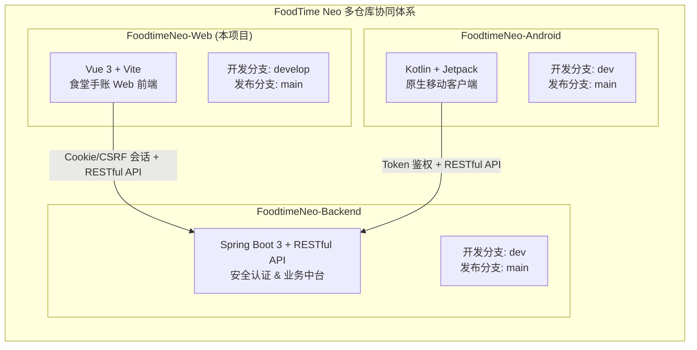
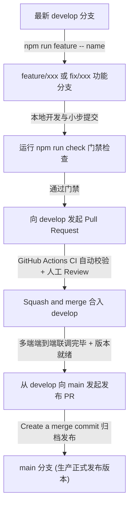

# 🍱 FoodtimeNeo-Web

当前版本 **1.0.0**；修复范围与验证结果见 [1.0.0 发布验收](docs/release-1.0.0.md)。

<div align="center">

### 校园食堂手账风美食点评与社区互动平台 · Web 前端工程

**以“复古食堂手账”为美学灵魂，基于 Vue 3 + Vite 构建的高性能、工程化响应式校园餐饮多端生态前端**

<p align="center">
  <a href="https://github.com/FoodtimeNeo/FoodtimeNeo-Web/tree/develop"></a>
  <a href="#-多仓库体系与工程边界"></a>
</p>

<p align="center">
  <a href="https://vuejs.org/"></a>
  <a href="https://vite.dev/"></a>
  <a href="https://pinia.vuejs.org/"></a>
  <a href="https://element-plus.org/"></a>
  <a href="https://nodejs.org/">=24-339933?style=for-the-badge&logo=nodedotjs&logoColor=white" alt="Node.js"></a>
</p>

<p align="center">
  <a href="https://vitest.dev/"></a>
  <a href="https://eslint.org/"></a>
  <a href="https://prettier.io/"></a>
  <a href="https://nvie.com/posts/a-successful-git-branching-model/"></a>
  <a href="#-多仓库体系与工程边界"></a>
</p>

[✨ 效果与美学展示](#-视觉美学与效果展示) • [📢 评审速读](#-评审审查速读) • [🏛️ 系统架构](#-多仓库体系与工程边界) • [🌿 Git流向](#-开发集成与发布流程规范) • [🚀 快速开始](#-快速上手与本地运行) • [📚 技术文档](docs/README.md)

</div>

---

> [!IMPORTANT]
>
> ### 📢 评审审查速读
>
> 1. 🌿 **日常开发在 `develop`，等正式开发完毕才合并进 `main`**  
>    本项目严格遵循工程规范，`main` 仅作正式发布归档（故提交较少）。**查看完整开发轨迹与最新代码，请务必切换至 [👉 develop 分支](https://github.com/FoodtimeNeo/FoodtimeNeo-Web/tree/develop)**（或查看 [PR 审查记录](https://github.com/FoodtimeNeo/FoodtimeNeo-Web/pulls?q=is%3Apr+is%3Aclosed)）。
> 2. 📦 **本项目共有 3 个独立仓库，当前仅为 Web 前端**  
>    系统采用三端解耦架构，由三个独立仓库组成：**[🌐 Web 前端 (本仓库)](https://github.com/FoodtimeNeo/FoodtimeNeo-Web)** ｜ **[⚙️ 后端 API (FoodtimeNeo-Backend)](https://github.com/FoodtimeNeo/FoodtimeNeo-Backend)** ｜ **[📱 安卓端 (FoodtimeNeo-Android)](https://github.com/FoodtimeNeo/FoodtimeNeo-Android)**。各仓库独立维护，单端合并并不代表全项目发布。

---

## 🎨 视觉美学与效果展示

FoodtimeNeo-Web 彻底打破了传统管理系统千篇一律的 SaaS 扁平风，以**复古“食堂手账”（Zine Journal）**为核心设计语言，带来极富温度与生活气息的视觉体验。

### 1. 手账设计语言 (Design Philosophy & Tokens)

- 📜 **纸质拟物基底**：牛皮纸桌面背景（`#d8c08b`）搭配米白色手账内页卡片（`#fffaf0`）。
- 🏷️ **复古拼贴点缀**：定制 SVG 邮票、撕纸边缘（Torn Edge）、朱红火漆印章、纸胶带（Washi Tape）与手绘批注涂鸦。
- 📐 **硬朗边框与深墨投影**：采用硬边实色投影（Hard Solid Shadow）与深墨棕描边（`#3a2418`），杜绝泛滥的大圆角与毛玻璃阴影。
- 📱 **自适应响应式**：桌面端呈现沉浸式手账大画卷；移动端（≤768px）自适应转化为轻量、流畅的高效 App 体验（具备原生底栏 Tab 导航与手势触控）。

```
        桌面端 (Desktop HandBook Style)                    移动端 (Mobile App Style)
┌───────────────────────────────────────────────┐           ┌───────────────────┐
│ [邮票] FoodTime Neo 手账   [食堂] [社区] [登录]│           │ [手账] 发现好味道 │
├───────────────────────────────────────────────┤           ├───────────────────┤
│ ┌── 胶带贴纸 ───────────────────────────────┐ │           │ ┌───────────────┐ │
│ │ 🍱 推荐：学苑一楼主打 招牌油泼面   [4.8★] │ │           │ │ 🍱 油泼面 4.8★│ │
│ └───────────────────────────────────────────┘ │           │ └───────────────┘ │
│ ┌─ 食堂手账卡片 ──┐ ┌─ 菜品详情与点评 ─────┐ │           │ ┌───────────────┐ │
│ │ 学苑食堂 (11档口) │ │ 📸 菜品分页图册      │ │           │ │ 学苑 (11档口) │ │
│ │ 评分：4.6 分     │ │ 📝 附属真实点评      │ │           │ └───────────────┘ │
│ │ [查看当季菜单]   │ │ 🏷️ 审核印章：[PASS]  │ │           ├───────────────────┤
│ └─────────────────┘ └──────────────────────┘ │           │ [首页] [食堂] [我的│
└───────────────────────────────────────────────┘           └───────────────────┘
```

### 2. 核心功能路线矩阵

| 业务领域           | 核心能力与页面                               | 界面特色与交互设计                                                          |
| :----------------- | :------------------------------------------- | :-------------------------------------------------------------------------- |
| **食堂与档口导览** | `CanteenListView` / `CanteenDetailView`      | 食堂卡片多列瀑布排布、楼层筛选、档口缩略图、真实评分徽章展示                |
| **菜品与专属图册** | `DishDetailView` / `DishGalleryView`         | 菜品信息挂载、参考价格标签、每日评分快照、分页高分辨率图册浏览              |
| **菜品附属点评**   | `DishReviewCreateView`                       | **表单严格附属于指定菜品**（不可跨菜品伪造），支持手账星级评分与富文本心得  |
| **社区与投稿 UGC** | `SubmissionCreateView` / `CommunityFeedView` | 菜品/档口投稿、图片上传即时预览、个人投稿状态生命周期追踪（待审/通过/驳回） |
| **后台审核与管控** | `AdminAuditView` / `ManagedReviewsView`      | 内容管理员与平台管理员分权、审核日志溯源、违规评论下架、用户状态流转        |

---

## 🏛️ 多仓库体系与工程边界

FoodTime Neo 采用多端解耦架构。三个子仓库职责划分明确、接口边界清晰：



### 三端仓库矩阵表

| 仓库名称                     | 核心职责与技术栈                        | 开发集成分支 | 正式发布分支 |                             仓库主页                              |
| :--------------------------- | :-------------------------------------- | :----------: | :----------: | :---------------------------------------------------------------: |
| **FoodtimeNeo-Web** (本项目) | Vue 3.5 / Vite 8 / Pinia / Element Plus |  `develop`   |    `main`    |   [🔗 查看仓库](https://github.com/FoodtimeNeo/FoodtimeNeo-Web)   |
| **FoodtimeNeo-Backend**      | Spring Boot 3 / MyBatis / MySQL / Redis |    `dev`     |    `main`    | [🔗 查看仓库](https://github.com/FoodtimeNeo/FoodtimeNeo-Backend) |
| **FoodtimeNeo-Android**      | Kotlin / Jetpack Compose / OkHttp       |    `dev`     |    `main`    | [🔗 查看仓库](https://github.com/FoodtimeNeo/FoodtimeNeo-Android) |

> 📌 **注**：三个仓库独立管理和发布。一个仓库的分支合并状态仅代表该仓库进度，不能据此推断其他两端或全项目已完成发布。

---

## 🌿 开发、集成与发布流程规范

Web 端严格遵循标准的自动化分支流向，杜绝混乱提交，确保每个发布版本的绝对稳定性：



### 研发步骤执行细则

1. **创建功能分支**：从最新的 `develop` 创建 `feature/<name>` 或 `fix/<name>`，使用工程内置脚本执行：
   ```sh
   npm run feature -- canteen-list
   ```
2. **小步提交与自测**：在功能分支上完成业务，遵循清晰的 Conventional Commits 提交规范。
3. **本地门禁校验**：合并前在本地必须通过 `npm run check`（涵盖 Lint、格式、222 项单元测试与生产打包）。
4. **合入集成分支**：向 `develop` 提交 PR，经 CI 流水线验证无误并经 Review 后合入。
5. **发布到生产分支**：待三端联调完备，由 `develop` 发起发布 PR 合入 `main`。**日常开发严禁直接向 `main` 提交代码**。

---

## 🛠️ 技术栈与工程实践

| 维度          | 选用技术 / 方案                  | 选型优势与工程实践                                         |
| :------------ | :------------------------------- | :--------------------------------------------------------- |
| **核心框架**  | `Vue 3.5` (Composition API)      | 全面拥抱 `<script setup>` 与组合式函数，逻辑高度内聚       |
| **构建工具**  | `Vite 8.0`                       | 秒级极速热重载 (HMR)，开箱即用的现代化 ESM 打包工具链      |
| **状态管理**  | `Pinia 2.3`                      | 轻量化、类型安全的状态管理，严格区分页面局部与全局跨端状态 |
| **路由系统**  | `Vue Router 4.5`                 | 集中式路由表设计，配套严格的全景权限守卫与动态标题拦截     |
| **UI 基础库** | `Element Plus 2.9`               | 深度定制手账风格变量，与原生手账风格无缝融合               |
| **网络通信**  | `Axios 1.7`                      | 封装支持 Cookie / CSRF 校验，支持请求中断与同站反向代理    |
| **测试套件**  | `Vitest 4.1` + `@vue/test-utils` | **222 项测试全绿**，覆盖组件、视图、组合式函数与接口层     |
| **代码规范**  | `ESLint 10` + `Prettier 3`       | 全项目 **0 Warning** 零容忍质量门禁，保持代码格式高度一致  |

---

## 🚀 快速上手与本地运行

### 1. 环境准备

确保本机安装了 Node.js 24 或更高版本：

```sh
node -v   # >= v24.0.0
npm -v    # >= 10.0.0
```

### 2. 安装依赖

```sh
npm ci
```

_(注：Windows PowerShell 下若执行策略受限，可使用 `npm.cmd ci`)_

### 3. 本地启动开发服务器

#### 模式 A：本地全栈联调（默认代理到本机后端 8080）

```sh
npm run dev
```

启动后在浏览器打开：`http://localhost:5173`。

#### 模式 B：线上真实数据代理预览（直接联调远程服务器）

无需在本地部署后端和数据库，即可通过开发代理体验真实线上数据：

- **PowerShell (Windows)**:
  ```powershell
  $env:VITE_API_PROXY_TARGET='https://kfcvivo50.ddns.net'
  npm.cmd run dev -- --port 5173
  ```
- **Bash (macOS / Linux)**:
  ```bash
  VITE_API_PROXY_TARGET="https://kfcvivo50.ddns.net" npm run dev -- --port 5173
  ```

---

## 🧪 自动化测试与工程门禁

为了确保进入主干的代码具备工业级健壮性，本项目建立了严格的 CI/CD 质量门禁：

```sh
npm run check
```

该命令将严格依序执行以下四道质检流水线：

1. `npm run lint`：ESLint 严格静态代码检查（**要求 0 Warning**）。
2. `npm run format:check`：Prettier 源码风格排版检测。
3. `npm run test:unit`：运行 Vitest 单元与集成测试（**56 个测试文件、222 项测试全数通过**）。
4. `npm run build`：生产环境打包编译，确保产物树无缺失。

---

## 📂 项目工程目录拓扑

```text
FoodtimeNeo-Web/
├── .github/
│   ├── workflows/ci.yml         # GitHub Actions 自动化门禁工作流
│   └── pull_request_template.md # PR 规范化审查模板
├── docs/                        # 完整设计与架构文档沉淀（见文末矩阵）
├── public/                      # 静态资源与离线 Service Worker
├── scripts/
│   ├── git/                     # Git 分支流向自动化辅助与 PR 校验脚本
│   └── dev/                     # 本地 / 线上代理目标地址验证脚本
├── src/
│   ├── api/                     # 领域划分接口层（对齐 RESTful 规范）
│   ├── assets/
│   │   ├── images/              # 食堂、档口、菜品等静态画册素材
│   │   ├── styles/              # Design Tokens 手账视觉变量与全局样式
│   │   └── zine/                # 复古印章、胶带、撕纸边缘等 SVG 贴纸资产
│   ├── components/
│   │   ├── base/                # 手账风纯基础组件（卡片、图章、按钮等）
│   │   ├── canteen/             # 食堂与档口领域交互组件
│   │   ├── community/           # 社区动态、评论与发帖交互组件
│   │   ├── layout/              # 响应式外壳（PC 顶栏 / Mobile 底栏 Tab）
│   │   └── review/              # 星级手账评分与评价组件
│   ├── composables/             # 抽象业务逻辑组合式函数（useAsyncData 等）
│   ├── router/                  # 集中式路由配置与角色权限守卫
│   ├── store/                   # Pinia 全局状态（用户会话、身份鉴权）
│   ├── utils/                   # 纯函数工具库（URL 处理、输入校验）
│   ├── views/                   # 页面层（按业务领域划分子目录）
│   ├── App.vue                  # 根组件
│   └── main.js                  # 入口主文件
├── CLAUDE.md                    # 智能编码与协作规则
├── vite.config.js               # Vite 构建、代理及 Vitest 测试配置
└── package.json                 # 依赖、脚本与元数据
```

---

## 📚 技术文档矩阵 (Documentation Hub)

完整的工程化决策、视觉基线与验收报告已系统化收录于 `docs/` 目录：

| 文档模块          | 对应路径                                                   | 核心要点说明                                |
| :---------------- | :--------------------------------------------------------- | :------------------------------------------ |
| **系统分层架构**  | [docs/architecture.md](docs/architecture.md)               | 目录职责、依赖单向流向、跨层调用约定        |
| **Git 协作规范**  | [docs/git-workflow.md](docs/git-workflow.md)               | 分支命名、Rebase 策略、PR 审查与合并流向    |
| **视觉设计规范**  | [docs/design-style-web.md](docs/design-style-web.md)       | 食堂手账视觉语言、Design Tokens、响应式断点 |
| **后端接口契约**  | [docs/backend-integration.md](docs/backend-integration.md) | 接口映射、Cookie/CSRF 认证、数据安全边界    |
| **本地联调指南**  | [docs/local-development.md](docs/local-development.md)     | 本地与远程代理机制、账号调试与故障排查      |
| **CI 与交付标准** | [docs/ci-cd.md](docs/ci-cd.md)                             | GitHub Actions 门禁规则、自动化触发机制     |
| **工程验收记录**  | [docs/verification.md](docs/verification.md)               | 真实环境端到端验证记录、测试覆盖率历史证据  |

---

<div align="center">
  <small>FoodTime Neo Team · Dedicated to Delivering Better Campus Dining Experiences</small>
</div>
